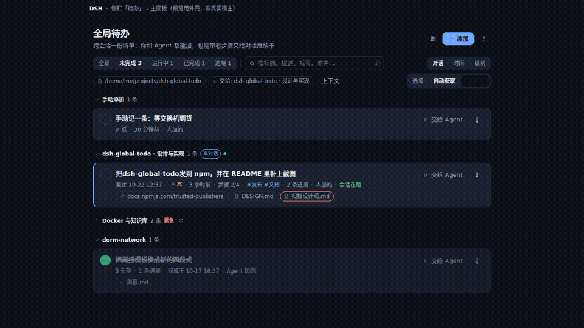
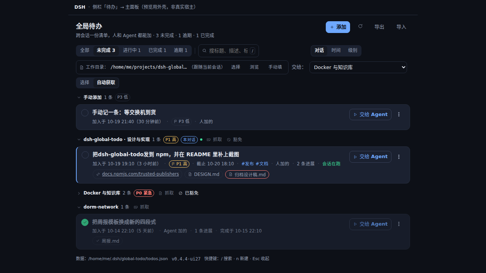
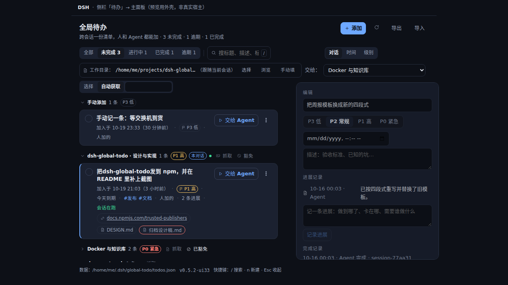
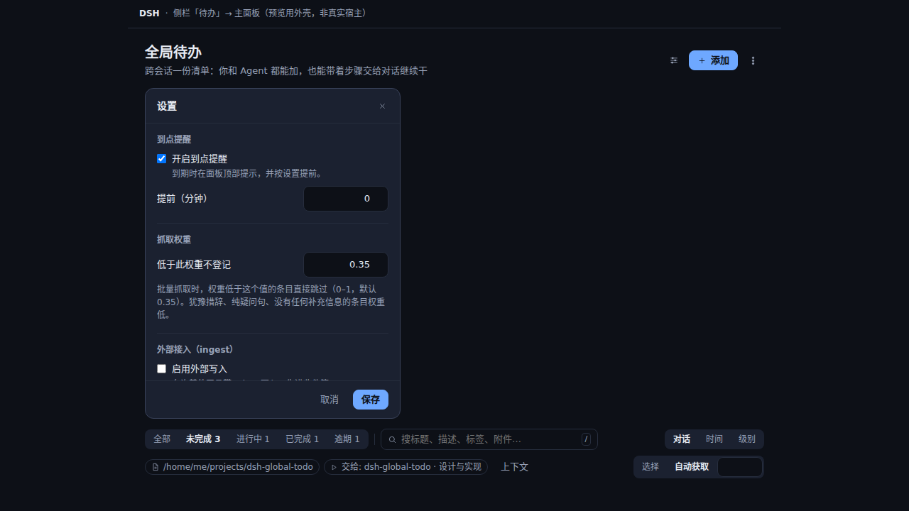
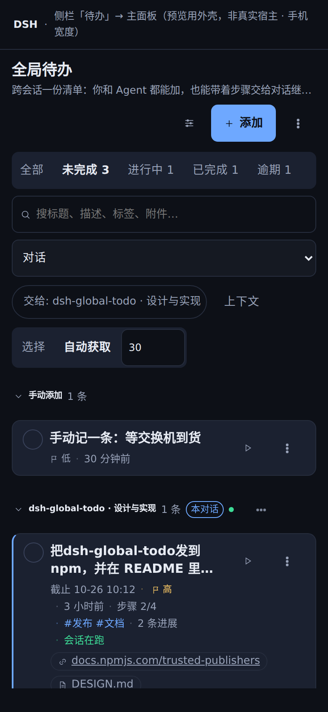

**中文** · [English](https://github.com/LUgABeEEE/dsh-global-todo/blob/main/README.en.md)

# dsh-global-todo · 全局待办


**一份跨会话的待办清单：一个属于你的文件，你和 Agent 读写同一份，一键交给某个对话继续干。**

三件会话级计划做不到的事——第一件是这个插件最要紧的一条：

1. **Agent 说「做完了」不算数，两个入口都只是声明**。它自己在工具里报完成是一种，交给的会话干净收尾、
   宿主替它收尾是另一种；两条路都只把记录送进**待确认**。人点「确认完成」才算完成，点「退回清单」
   就回到清单里、完成记录一并清掉。会话级计划没人问这一句：Agent 把表一改，事情就算结束了。
2. **一个 JSON 文件就是全部**。能 `cat`、能 diff、能提交进仓库、能放 NAS、换机带走——不藏在任何会话日志里。
3. **交接是一个按钮，不是一段话**。四种模式、会先检查工作目录，待办自己的**步骤**会作为编号计划一起交出去。



```sh
dsh plugin add dsh-global-todo
```

[在线主页](https://lugabeeee.github.io/dsh-global-todo/)（22 秒排版演示）· [English](https://github.com/LUgABeEEE/dsh-global-todo/blob/main/README.md#english) · [5 分钟上手](docs/QUICKSTART.md) · [常见问题](docs/FAQ.md) · [每个条件状态都有基线图](#截图) · [设计说明](docs/DESIGN.md)

---

## 它补的是哪个缺口

DSH 自带的 `todo_write` 属于**某一个 agent 会话**：整表替换、三个状态、会话一关计划就翻篇。
社区里解决这件事的插件分成两派：一派擅长**把活派给 Agent**（自动续跑、绑定会话），
一派能收**真正的文档附件**。这个插件把两件事放在同一条记录上：

| | 自带 `todo_write` | dsh-global-todo |
|---|---|---|
| 归属 | 一个 agent 会话 | **你**——跨会话、跨工作区 |
| 写入方式 | 整表替换 | 逐字段，**人和 Agent 都能写** |
| 加入时间 | 不记录 | **`createdAt` 只写一次，处处可见** |
| 上下文 | 标题 + 状态 | 描述 + **文档与地址** |
| 交给 Agent | 无 | **一键：复用已绑定会话，或新开一个** |
| 标成完成 | Agent 改了就算 | **进「待确认」，人点头才算完成** |
| 存储 | 会话事件日志 | 一个 JSON 文件，能 `cat`、能手改、能 diff、能备份 |

## 完成确认：没有一条记录能自己变成「完成」

这是它最容易被记住的一条，也是它和所有「让 Agent 自己报进度」的清单最不一样的地方：
**Agent 说「做完了」，只是它说了这句话。** 记录写完是 `done`，同时带上
`review: { pending: true }`；行上有「待确认」徽标，顶部有带计数的筛选，直到人回答为止。

两个入口都受同一条规则管，因为它们同样只是声明：

| 「做完了」从哪来 | 记录变成 | 谁来回答 |
|---|---|---|
| Agent 调 `global_todo_done`，或把状态改成 `done` | `done` **+ 待确认** | 人 |
| 交给的会话干净收尾，宿主自动收尾（`turn/end` 是 `completed`） | `done` **+ 待确认** | 人 |
| 你自己在面板里点完成 | `done` | 已经是人 |

- **回答只有两个**：「确认完成」清掉标记，动态里记下是谁确认的；「退回清单」回到 `open`，
  清空 `doneAt` 与完成记录，动态里加一条 `reopened`。标题、描述、步骤、附件、进展一条不删。
- **自动收尾也走这个门**。宿主替 Agent 写的那份完成记录本来就更薄——只有最后一段回复和这一轮
  改过的文件——它更没理由自己算数。
- **只有干净收尾才是候选**：`error`、`aborted`、`interrupted`、`max-tokens` 一律留着未完成。
  一轮失败的任务挂着「完成」标签，是让整份清单不可信的唯一起点。

规则在代码里只有一个实现：`completeTodo`、`applyPatch` 和状态改写共用 `lib/model.js` 里那个
`by === 'agent'` 判断，面板和十个工具都走它。

## 0.9 / 0.10 补了什么（以及再往前两版）

五件这两份 README 一直没讲的能力：会话回读与原话是 0.9 的，Markdown 与本周报告是 0.10 的，
步骤是 0.8 的。每一个都改变了记录能装什么，或者改变了事后能拿它做什么。
（还有一件是 0.7 的「待确认」，它现在就是开头那条规则，不在这里当新功能讲。）

### 步骤：待办里的一份计划

一条待办最多 20 个步骤、每步 200 字（`lib/model.js` 的 `LIMITS`）。步骤是 `{ text, done }`——
一条工作里的一行，不是有自己 id 和状态的子任务。

- **加**：新增表单的「更多字段」→ 步骤，一行一步。
- **勾**：详情里每步一个勾选框；行上显示「步骤 2/5」。
- **交出去**：派发提示词会把步骤编号，已完成的加 `[已完成]` 前缀。
- **导出**：Markdown 里写成缩进的 `- [ ]`，导入时读回来。

### 原话：这条是从哪句话来的

`evidence` 是抓取时那条待办**来自的原话**，逐字引用，最多 300 字。`global_todo_capture` 会向模型要它，
`global_todo_add` 也收，详情里以引用块显示在「原话」下面；你自己敲的条目没有这一项。

它只为一件事存在：没有出处的一次抓取，过几天看起来就像一句观点。Markdown 导出里也有这一行（`原话:`）。

### 会话回读

派发是在**另一个对话**里开工，所以详情要能回答「它说了什么」，不用切过去。
`GET /api/global-todo/session?id=` 返回 `alive`、`dir` 和最后一条 assistant 消息的 `tail`；
详情里就是「会话回读」：在跑 / 已休眠、最后一句，以及一个打开该对话的按钮。

tail 有上限、只在内存里：200 个会话、每个 400 字，来自每条 `assistant/message`。不落盘，宿主一重启就忘。
查不到 tail 是正常情况——这个进程没见那个对话说过话。

### Markdown 进与出

JSON 导出是往返格式；Markdown 是拿来读、diff、手改的那份：

```text
- [ ] 标题
      优先级: 高 · 截止: 2026-10-21T18:00 · 标签: 发布, 文档
      原话: …
      描述: 第一行
      - [x] 一步
```

| 方向 | 入口 | 行为 |
|---|---|---|
| 出 | **更多操作 → 导出 Markdown**，或 `GET /export?format=md` | 按「未完成 / 已完成 / 已归档」分组，元数据缩进在每条下面 |
| 入 | **更多操作 → 导入**（选 `.md`），或 `POST /import { markdown }` | 走正常 `create` 新建；Markdown 没有 id，所以**永远不会覆盖**已有记录 |

解析是容错的：不认识的行直接忽略，日期解析失败就丢掉那一项，整份文件里没有一行 `- [ ]` 会明确报错。
字段标注固定是中文（`优先级 / 截止 / 标签 / 原话 / 描述 / 附件 / #`），导入按同一套读。

### 本周报告

**更多操作 → 本周报告**（`GET /report?days=7`）回答「这一周动了什么、有没有落到代码上」。
全部从完成记录推出来，不存任何东西。

| 字段 | 含义 |
|---|---|
| `finished` | 窗口内完成的条目，最新在前，带完成者和说明 |
| `sessions` | 这些完成来自多少个不同的对话 |
| `created` | 窗口内新增的条数 |
| `pendingReview` | 已完成但还没人回答的条数 |
| `files` | 触及的文件，按次数排序——列 12 个，`fileCount` 是总数 |

`days` 超过 90 会被压到 90；缺省或非正数按 7 算。

## 截图









每个「只在特定情况下出现」的面板状态都有一张固定基线图，由同一套预览渲染、同一支工具拍摄，改样式时可以直接对比：

| 状态 | 图片 |
|---|---|
| 清单为空 | [`panel-empty.png`](docs/screenshots/panel-empty.png) |
| 筛选无结果 | [`panel-filtered.png`](docs/screenshots/panel-filtered.png) |
| 收件箱（待确认） | [`panel-inbox.png`](docs/screenshots/panel-inbox.png) |
| 待确认（Agent 完成） | [`panel-review.png`](docs/screenshots/panel-review.png) |
| 到点提醒 | [`panel-reminders.png`](docs/screenshots/panel-reminders.png) |
| 批量选择 | [`panel-select.png`](docs/screenshots/panel-select.png) |

图都由 `npm run screenshots`（内部串起 `npm run preview`）生成：先把真实的客户端半区渲染成静态
HTML（不依赖宿主、零依赖），再以 1280×720 拍进 `docs/screenshots/`。Playwright 不是依赖——工具
借的是 DSH profile 里已经装好的那份，或 `DSH_PLAYWRIGHT` 指向的那份。

手机档同一支工具拍：`npm run screenshots:mobile` 先按 **390×844** 渲染同一棵组件（夹具会把面板的
实测宽度答成 390，所以窄屏分支是真的被执行，不是把桌面布局缩小），再拍进 `docs/screenshots/mobile/`。

每张图显示什么状态、什么时候重新生成，见 [docs/screenshots/README.md](docs/screenshots/README.md)。

## 环境要求

- DeepSeek Harness `0.2.x`（按 `0.2.1-rc.2` 开发与验证；`engines.dsh` 是 `>=0.2.0-rc.1 <0.3.0`，
  区间外的宿主会**整层跳过**这个 bundle，不是警告）
- Node.js `>= 22.19.0`（Web profile 本身的要求）
- **Web 客户端**：面板由宿主的 web server 提供。headless / ACP / SDK 只有 Agent 工具、没有面板；
  Electron 式桌面端（file:// + IPC）暂不支持
- 宿主升级后要**刷新页面**——客户端模块图属于页面启动时那个 release
- **零运行期依赖**，也不 import 任何 `@deepseek-ai/*` 包

## 安装

**先确认 profile 名字。** 插件是装进某个 profile 的，不是装进整台机器；profile 名写错，
命令会成功，但重启后侧栏里什么都没有——这是最常见的一次踩坑。

```sh
ls ~/.dsh/profiles          # Windows: dir %USERPROFILE%\.dsh\profiles
```

把下面命令里的 `<profile>` 换成上一步列出来的那个（本机常见是 `web`；用桌面端就填桌面端的
profile 名，用 headless 就填 `headless`）：

```sh
# 从 npm 装
dsh plugin --profile <profile> add dsh-global-todo

# 或从本地检出装（也是开发路径）
dsh plugin --profile <profile> add /绝对路径/dsh-global-todo
```

插件是宿主组合里的**一行 Loader**，不是热加载脚本：**装完要重启宿主**（`dsh web`，
或你用的那个启动命令），再刷新页面。侧栏会出现「待办」入口。

> 侧栏还是空的？按顺序查三件事：① 上面的 `ls` 里到底有哪几个 profile，你装的是不是正在跑的那个；
> ② 宿主有没有真的重启（Loader 只在启动时读一次）；③ 页面有没有刷新（客户端模块图属于
> 启动时那个 release）。

### 从 DSH 的 Discover 标签安装

DSH 的 Discover 标签读的是**你自己添加**的一个 JSON 索引（官方不带索引），这也是唯一一条
不用手抄命令的安装路径。本仓库发布了一份：

```text
https://lugabeeee.github.io/dsh-global-todo/market/index.json
```

它由 `npm run market` 从 npm 生成（`docs/market/index.json`），写入前会用 DSH 自己的
`@deepseek-ai/dsh-plugin-market-index` 校验一遍。**索引里的最新版本与 `package.json` 不一致时
`npm test` 会失败** —— 发版后忘了重新生成，会在发出去之前就被拦下。

**如果你是手动拷贝目录（而不是从 npm 装）**，先自检一遍，别靠猜：

```sh
npx dsh-global-todo-doctor "$HOME/.dsh/plugins-local/全局待办插件"
# Windows: npx dsh-global-todo-doctor "$env:USERPROFILE\.dsh\plugins-local\全局待办插件"
```

它逐项检查 manifest、patch 文件、两个入口、`locale/`、图标和 `lib/`；缺必需项时退出码为 1。
最容易漏的是 `locale/`——少了它插件照样加载，但桌面端会报
`Plugin metadata … ENOENT … \locale`。

npm 上的包才是事实来源。社区目录可能落后于 npm、或指向某个旧 release；需要确定版本时
直接钉版本（`dsh plugin --profile <profile> add dsh-global-todo@0.13.1`）。

回滚：

```sh
dsh plugin --profile <profile> remove dsh-global-todo
```

装卸都不会碰你的清单——它在插件之外：`$DSH_HOME/global-todo/todos.json`。

## 怎么用

### 面板

- **图片附件**：附件也可以写成 `{ "kind": "image", "value": "/绝对路径/shot.png" }`，行上显示缩略图、详情里显示预览；字节按需读取（png/jpg/jpeg/webp/gif/avif，≤8MB），**不复制进清单**。
- **添加**：写一句标题回车即存。「更多字段」展开描述、附件框（一行一个文档绝对路径或网址）、
  标签、优先级、截止时间。
- **筛选**：全部 / 未完成 / 进行中 / 已完成 / 逾期，外加跨标题、描述、标签、附件的文本搜索；
  顶部的统计胶囊本身就是筛选按钮。
- **按紧迫度分组**：逾期 / 今天 / 接下来 / 以后 / 没有截止时间 / 已完成，每组可折叠——
  「哪件已经晚了」是清单要回答的第一个问题。
- **每一行**显示「加入于 10-13 22:47（3 小时前）」，悬停看精确时间戳；另有优先级、截止、
  标签、附件数，以及这条是**人加的**还是 **Agent 加的**。
- **详情**：就地改标题/描述/优先级/截止；挂上或摘掉文档与地址（每条都带「打开 / 复制路径」）；
  查看动态（谁在什么时候做了什么）。
- **删除可撤销**：删掉的记录保留 8 秒，点「撤销」原样恢复——同一个 id、同一个加入时间、同样的附件。
- **键盘**：`/` 聚焦搜索；新增输入框展开后，`n` 聚焦它；`Esc` 收起详情。行内操作在悬停或键盘聚焦时出现。
- **手机 / 窄屏**：面板按自己的**实测宽度**切换，≤600px 进入触控布局——按钮与输入框 44px 触摸尺寸，筛选胶囊横向滑动而不是被裁掉，行内「交给 Agent」收成图标（菜单与详情里仍是文字），键盘提示隐藏，底部让出安全区，正文跟随手机页的「文字大小」设置。桌面一字不变；`dsh-mobile` 的手机页不需要任何额外配置，也不改 DSH 与手机插件本身。
- **访问地址**：面板可以正常从宿主的**本机**、**受信任的局域网地址**（`--trusted-host` 里那些，如 `192.168.1.10:3080`）以及隧道访问——路由会交给宿主的连接围栏判断；只有宿主的围栏**不存在**时才退回「只接受本机请求」的保守检查。`/health` 里的 `fence` 会告诉你当前实际是哪一种。
- **自动获取（可关，默认关）**：面板上的「自动获取」开关。打开后——你在某个对话里**正常收完一轮**、那个对话**安静满 30 分钟**、且**你人就在那个对话里**（不是派发目标/子 Agent/后台任务），插件才会自动问它一次「有没有要跟进的事」。中断/失败的轮次不问。**它问过之后，只有你在那个对话里再说一句话才会重新问**——因为那条提问本身就是对话里的一条消息，会重置安静计时、并让它自己的回答收尾成一轮，曾经正是这一点让同一个对话整夜追着自己反复问；冷却只是次要的阻尼。开关是**宿主状态**（面板关着也生效，`/health` 可见），关掉就完全靠你和 Agent 手动记。另外每个对话分组旁边有一个**「豁免」**按钮：点一下就把**该对话所在的工作区**整个排除在自动获取之外（再点一下取消）。这是给由机器驱动的对话准备的——比如微信机器人所在的聊天区，它们的会话重启后会换新 id，所以豁免**记在目录上而不是某一条对话上**，才不会悄悄失效。
- **主动记**：插件会往 system prompt 里注入一段引导，列出该主动记的具体情形（跨会话的跟进、「先做 X 再 Y」、一轮收尾时发现还有一步），并明确写上「问用户要不要记是错的，直接记」。
- **「抓取」在每个对话的分组上**：让**那个对话**里的 Agent 把该跟进的事登记成待办，结果就归在它自己那组下面（分组名旁边那个「抓取」）。工具栏上的「从本对话抓取」只在**当前对话还没有分组**时出现——否则没地方点它。抓取对象没在运行会**先唤醒**再问（与派发同一条规则）。
- **工作目录**：`选择` 会用宿主的目录选择器；如果这个部署没挂载它（远程命名空间缺失），面板会自动改为**手动填路径**（`手动填` → 粘绝对路径 → `使用`），并说明原因——不会只丢一条看不懂的错误。
- **一键分配（多选）**：工具栏点「选择」→ 勾几条 → 「一键分配」。每条按**原对话 → 同工作区对话 → 你选的目标**的顺序尝试（是**尝试顺序**，不是一次定死：原对话加载不了就自动往下走）。都找不到的会**报回来并给你选择器**，绝不擅自送到别处；其中一条失败也不会中断整批。
- **搜索语法**：`tag:发布`（或 `#发布`）、`is:overdue`、`is:active`、`has:link`、`has:note`、`level:p0`（也可写 `level:urgent`）、`before:2026-11-01` / `after:2026-10-01`（按截止时间卡边界；日期没打完时只是不生效，不会报错），自由词之间是 **AND**，并且会一并搜进展记录。不带冒号的普通搜索行为不变。
- **进展记录**：每条待办可追加「谁在什么时候说了什么」的流水（行上显示条数，详情里看全文并可直接补一条）。Agent 报「做不完、卡在哪」应该写在这里，**而不是改写你的描述**。
- **失效附件会标出来**：文件被移走/删除的附件在行上标红、详情里注明；这个标记是**读取时算的**，不写进记录——文件回来了就不该再标红。
- **新对话开在哪**：默认**继承写下这条待办的对话所在的工作区**（新会话的工作目录也就是那个工作区），所以「接着这个活干」不会跑到不相干的工作区去；想指定就选 `＋ 新对话 · 工作区名`（列在工作区一栏里），指定的优先。只有当两者都不知道时，才退回按工作目录判断。
- **选择器按「最后使用」排序、不含已归档的对话**：顺序就是侧栏的 recency 键（`updatedAt`），最近用过的在最上；归档过的对话**完全不列**（归档的对话不是「这活该放哪」的答案）。同名对话会带一个短 id 后缀以免选错；如果当前目标已不在列表里（选完之后被归档），会显示为「（已归档）」而不是悄悄显示成另一个对话。
- **交给谁由你选**：工具栏上是 `交给：[ 对话名 ▾ ]`——**列出你的对话**，你点哪个就送哪个（显式选择以 `authoritative: true` 发下去，Host 原样照办，不再猜）。列表里会标注 Host 自己要选的那个（「最近说过话」）；想放回自动判定就选 `自动`，想要干净上下文就选 `＋ 开一个新对话`。选过一次会记住，换目标只需在这个下拉里改——**因为你看见的就是会发生的事**。
- **点完有回执**：派发成功后面板会弹出「已交给「对话名」——去那个对话看它的进展」，并带一个**「打开那个对话」**按钮直接跳过去。派发是在**另一个对话**里开工的，之前面板一声不吭，看起来就像「点了没反应」。
- **交给 Agent**：面板上先显示**这次要交给谁**，默认是 **`current` 当前对话**——也就是**你本人最近在里面写过消息**的那个对话（Host 读会话日志，只认 `source.kind=user` 的消息；**插件自己注入的派发消息不算**，否则每次派发都会把「当前对话」推向它自己刚派发的目标；面板打开时它自己那个「主视图保留的会话」可能是几小时前的陈旧值，所以活动流优先，只有「确实知道自己在哪个对话里」的调用方才能用 `authoritative: true` 覆盖）。想让它去别处就换：
  `auto` 优先复用这条待办已绑定的会话、其次是当前对话、最后才新开；`new` 总是新开对话；`bound` 只发给已绑定的对话，不在就明确报出原因。
  找不到任何可用的对话时**明确失败**，不会偷偷开一个新的。
- **分组维度**：工具栏上有 `对话 / 时间 / 级别` 三个维度，**默认按对话**——同一个 agent 对话提交的待办会**合并成一条**（显示「N 条」，点开才展开），这样几次「抓一下待办」不会把清单糊成一片。单条的对话直接显示那一行；没有来源对话的（在面板里手加的）归到「手动添加」。`时间` 是原来的逾期 / 今天 / 接下来 / 以后 / 没有截止时间，`级别` 按高 / 一般 / 低分组。
- **级别 P0–P3**：每条待办可设 `P0 紧急 / P1 高 / P2 常规 / P3 低`；接口两种写法都收（`priority: "P0"` 或 `"urgent"`），旧记录里的 high/normal/low 原样有效，默认 P2。行上有徽标，对话分组头显示组内**最高级别**，绿色小圆点表示该对话里还有在跑的会话。
- **从本对话抓取**：面板上一个按钮，把「请把这段对话里需要跟进的事用 `global_todo_capture` 抓一下」注入你正在说话的那个对话——聊着聊着把该跟进的事一次变成待办，不用自己一条条敲。提示词里同样写清了「不要记什么」（会话计划、闲聊、已完成的事），否则抓取只会制造噪音。
- **权重下限**：每条候选会被打一个 0–1 的权重（具体标题、截止时间、步骤、附件、原话、承诺措辞加分；「可能 / 也许 / 看看 / 再说」这类犹豫语、纯疑问句、没有任何补充信息的条目减分），低于设置里的 `captureMinWeight`（默认 0.35）就不登记，只在 `skipped` 里报出权重与原因。设置面板里可以直接改这个值。
- **自动完成**：派发出去的会话**干净结束**时，宿主自己把这条待办标成完成，并附上**它最后那段回复**作为完成说明、**这一轮改动的文件**作为产出——不用等模型记得调工具。面板上完成的行显示「完成于 …」加产出芯片，展开详情有「完成记录」段（说明 + 产出路径，可点开或复制）。
  两条护栏值得知道：**只对刚派发过的会话生效**（你在那个会话里随便聊两句不会把待办完成掉），**失败 / 中断的回合不标记完成**（宁可留着未完成，也不能让一份干砸的活显示成已完成）。
  你也可以自己收尾：`global_todo_done` 支持 `summary` 与 `artifacts`，那是主路径，自动收尾只是兜底。
- **工作目录**：工具栏上显示这次派发会让新会话在哪个目录开工。默认**跟随你当前所在的对话**（从界面侧的会话状态里读 `cwd`），
  也可以点「选择」自己指定（会记住，下次继续用），或点「跟随当前会话」清掉指定值。
  待办本身也记着它是**在哪个目录里被写下的**（Agent 通过工具写的时候从调用上下文取），派发时会继承；
  三者都没有时**拒绝派发**并说明原因——因为一个没有工作目录的会话里，agent 什么也做不了。

### Agent 工具

| 工具 | 用途 |
|---|---|
| `global_todo_add` | 登记一条：描述、附件、步骤、标签、优先级、截止时间；同时记下「在哪个工作目录、哪个会话里写的」 |
| `global_todo_note` | 追加一条**进展记录**（做到哪了、卡在哪、需要谁做什么）；不改写你的描述 |
| `global_todo_capture` | **一次登记多条**（批量抓取）：用户说「抓一下待办」，或你一轮里发现好几件要跟进的；逐条校验，坏的那条只跳过它自己 |
| `global_todo_list` | 按状态/标签/关键词查询，每条都带上加入时间 |
| `global_todo_get` | 读一条的全文，含附件与最近一次派发 |
| `global_todo_update` | 改任意字段，包括 `status`（`archived` 归档而不删除）；`""` 清空，`[]` 清空列表 |
| `global_todo_link` | 挂上或摘掉文档与地址 |
| `global_todo_done` | 标完成 / 标回未完成 / 标进行中 |
| `global_todo_reopen` | 把**被误标完成**的一条标回未完成（只做 `done` / `cancelled` → `open`）；本来就未完成的会被拒绝，动作按 agent 记进活动轨迹 |
| `global_todo_remove` | 永久删除（做完的请标记，不要删） |

### 实际联通检查

测试用的是替身；`npm run check:live` 检查的是**真正接上线的**宿主：面板实际会调的路由、它实际读的清单，
以及一条「删掉再撤销」之后仍然完整的记录。它会临时建一条记录，往返后逐字段比对（id、加入时间、附件、
标签、级别、截止、描述），确认绑定记录带 `sessionAlive` / `sessionDir`，最后即使失败也会删掉这条临时记录。
它需要一个在跑的宿主，所以不在 `verify` 里。

### 主动抓取

插件会往 system prompt 里注入一段引导（用 `guidance: false` 关掉）。它把两侧都写清楚：只写「记得记事」的
提示词只会制造噪音，而吵闹的清单比空清单更糟。

- **主动记**：用户提到需要跨会话跟进的事（等对方回复、下周要交、待确认的决定、答应别人的事）、
  一轮结束时还有一步不该在本会话继续、或用户说「记一下 / 别忘了 / 回头办」；
- **不要记**：你这一步就能做完的、本会话内的计划、纯闲聊；
- 记完用**一句话**说明记了什么，别复述整条描述；
- 用户说**「抓一下待办」**，就扫最近对话，用 `global_todo_capture` 一次登记，再回一句汇总。

边界是：它**只负责记，从不擅自开工**。清单属于人，开不开工是人决定的（见 [ROADMAP](docs/ROADMAP.md) 里的非目标）。

抓取不能变成噪音。写进去之前，同一个规范化标题（全半角、大小写、空格、标点都折叠掉）、
最近 72 小时内意思很接近的转述（按字符二元组的 Dice 相似度，0.8），以及 7 天内刚做完的同一件事，
都会被拒绝，并在记录上写出原因；已归档和已取消的条目不挡新条目。规则在 `lib/capture.js`，单独测试。

### HTTP 接口

面板通过这些路由读写宿主。有 connection 服务时走宿主的连接围栏，没有时退化为严格的
本机回环校验。

| 方法 | 路径 | 参数 |
|---|---|---|
| GET | `/api/global-todo/list` | `status`、`query`、`tag`、`sort`、`limit`——被截断时响应带 `matched` 与 `truncated` |
| GET | `/api/global-todo/dirs` | `path?`——列子目录，供面板内置的目录浏览器使用（宿主自己的选择器在时会优先） |
| GET | `/api/global-todo/get` | `id` |
| GET | `/api/global-todo/export` | ——（存储用的那份 JSON 文档；`?format=md` 给 Markdown 任务列表） |
| POST | `/api/global-todo/import` | `{ doc, mode?: replace\|merge, dryRun? }`——`replace` 是无损往返，`merge` 同 id 覆盖、新 id 追加（面板用的是这个）；`dryRun` 只返回 `wouldCreate` / `wouldUpdate`，不落盘 |
| POST | `/api/global-todo/reminders/ack` | `{ ids }`——这些已到期的提醒不再列出来 |
| POST | `/api/global-todo/note` | `{ id, text }`（追加进展记录） |
| POST | `/api/global-todo/capture` | `{ sessionId? }`（请当前对话把要跟进的事抓进清单） |
| POST | `/api/global-todo/bulk` | `{ ids, status?, addTags?, removeTags? }`——一次改一整批；失效的 id 进 `unmatched`，不会让整批失败 |
| POST | `/api/global-todo/ingest` | `{ items: [{ title, source: { kind }, confidence }], dryRun? }`，带 `Authorization: Bearer <settings.ingestToken>`——外部条目；置信度低于 `ingestConfirmBelow` 的先进收件箱 |
| GET | `/api/global-todo/health` | —（数据位置、统计、派发能力，以及**工具注册状态**与**自动收尾观察者是否挂上**——这两种失败是静默的，所以必须能查；还有 `metrics`：派发成功率、工具调用次数、清单增长；`autoCollect`：每个候选对话**为什么被问/没被问**、计次，以及设置文件是怎么加载进来的） |
| POST | `/api/global-todo/create` | `{ title, description?, links?, steps?, tags?, priority?, dueAt? }` |
| POST | `/api/global-todo/update` | `{ id, ...字段, by?: human\|agent }` |
| POST | `/api/global-todo/status` | `{ id, status, by?: human\|agent }` |
| POST | `/api/global-todo/remove` | `{ id }` |
| POST | `/api/global-todo/restore` | `{ todo }` —— 原样还原被删除的记录（撤销） |
| POST | `/api/global-todo/review` | `{ id, decision: confirm\|reject }` —— 回答 Agent 的完成声明 |
| GET | `/api/global-todo/report?days=7` | 这段时间里 Agent 完成了什么、触及了哪些文件 |
| GET | `/api/global-todo/session?id=` | 绑定的会话最后说了什么（`tail` / `alive` / `dir`） |
| POST | `/api/global-todo/relink` | `{ id, index, value }`——把失效附件重新指向（新值仍须是该类型的合法绝对路径/网址） |
| GET | `/api/global-todo/asset?id=&index=` | 读**图片附件**的字节（路径只从待办记录里取，不接受请求传路径；≤8MB，png/jpg/jpeg/webp/gif/avif） |
| POST | `/api/global-todo/link` | `{ id, add?: [...], remove?: [值 或 下标] }` |
| POST | `/api/global-todo/dispatch` | `{ id, mode?: auto\|bound\|new\|current, sessionId?, dir? }` |
| POST | `/api/global-todo/assign` | `{ ids, items?, target?, dir? }`——一次把多条交给 Agent；配不上的 id 原样报回，不擅自送到别处 |
| POST | `/api/global-todo/settings` | `{ autoCollect?, idleMinutes?, cooldownMinutes?, exemptWorkspaces?, captureMinWeight? }`——自动获取的开关与阈值；`captureMinWeight`（0–1，默认 0.35）是批量抓取的权重下限，低于它的候选只在 `skipped` 里报出、不登记 |
| POST | `/api/global-todo/diagnostics` | `{ scope, status?, reason?, message?, url? }`——面板自己上报的错误 |

`/update` 与 `/status` 的 `by` 说明这次写是谁做的：不传（面板就是这样）就是人在键盘前，
脚本替 agent 干活时写 `by: 'agent'`，而不是被记成人的操作。传别的值是 `400`——
一个会把笔误悄悄收下的来源字段，比没有这个字段更糟。

错误是带类型的：非法值 `400`、id 不存在 `404`、请求体过大 `413`、过不了围栏 `403`、
够不到 agents 服务 `502`。响应体始终是 `{ ok, ... }`，并带机器可读的 `reason`。

## 数据放在哪

`$DSH_HOME/global-todo/todos.json`，也可以指定任意绝对路径：

```yaml
# profile 的 cordis.patch.yml
- id: global-todo
  config:
    storePath: /home/me/notes/global-todos.json   # 放进同步盘或版本库
    dispatchDir: /home/me/projects/thing          # 新会话的默认工作目录
    requireExistingFiles: true                    # 文件还不存在就先不让挂
    toolGroups: all                               # all（10 个工具）| core（6 个：只操作清单）| none
```

**文件本身就是产物**：纯 JSON、一条记录一个待办，写入走「临时文件 + rename」。
同一个进程里，人和 Agent 的编辑走同一条串行链；**跨进程**还有一把文件锁：写之前先独占建出
`todos.json.lock`，另一个宿主进程（Web 面板 + 桌面端 / 命令行会话，或两台机器共用一份同步盘）
只能在旁边排队，等不到 5 秒就明确报 `store-busy`（503）而不是默默把你的改动覆盖掉。
文件坏了会明确报 `store-corrupt` 而不是被静默清空；单条记录坏了只跳过那一条。
备份就是复制这个文件（外加确认没有 `.lock` 残留——正常情况下它写完就没了）。

同一个目录里还有 `settings.json`（宿主侧开关）和 `client-errors.log`（面板错误日志，有上限）；
**备份只需要 `todos.json`**。如果 `.lock` 一直在、而且写入一直报 `store-busy`，说明有进程正持有锁——
先确认没有第二个宿主在用同一个 `storePath`，再按 [FAQ 第 9 问](docs/FAQ.md) 处理。

## 收录情况

npm 是唯一安装源，下面每个地方都只是「能不能被找到」。核对日期 2026-10-21；复核用
`node tools/listings.mjs`，不要只信这张表。

| 渠道 | 形式 | 状态 |
|---|---|---|
| [npm](https://www.npmjs.com/package/dsh-global-todo) | 包本体 | `0.11.2` |
| [1024 Store](https://deepseek1024.com) | 目录条目（[PR #654](https://github.com/imsai-sh/awesome-deepseek-harness-plugins/pull/654) 已合并） | 已收录；安装行仍解析成 GitHub 源 |
| [dsh.pub](https://dsh.pub/zh/plugins/dsh-global-todo/) | 目录页 + `dshpub` CLI | 已上线，pin 到某个 commit |
| [DSH-Plugins-Marketplace](https://github.com/bradeGithub/DSH-Plugins-Marketplace) | `registry.json`，按 `dsh-plugin` topic 采集 | `v0.11.2`，风险分级 `safe` |
| [awesome-dsh-plugin](https://github.com/awesome-dsh-plugin/awesome-dsh-plugin)（19.7k★） | 每个插件一个 YAML | 已合并（[PR #7498](https://github.com/awesome-dsh-plugin/awesome-dsh-plugin/pull/7498)） |
| [walkinglabs](https://github.com/walkinglabs/awesome-deepseek-harness-plugins) | 带来源核验的 README | 已合并（[PR #114](https://github.com/walkinglabs/awesome-deepseek-harness-plugins/pull/114)） |

另有五个在审（Zhiyuan-Fan、kejixiaoliang、beancookie、dshworks、losebird），一个维护者已承诺
下次提交收录（dshopen.org）。完整表格、以及我们尚未逐条核实的 topic 自动采集渠道，见
[docs/DISTRIBUTION.md](docs/DISTRIBUTION.md)。

## 设计取舍

**附件是引用，不是上传。** 文档就是一个原地不动的绝对路径，地址就是一个 URL。
插件不复制任何字节：文档依然可编辑、可 diff，清单保持小巧，被派发的 Agent 用
自己的工具打开的就是同一个文件。带用户名密码的 URL 一律拒绝——否则清单、动态记录和
每一次派发提示词里都会留下那份凭据。

**加入时间是一等公民。** `createdAt` 写入一次、永不改写；面板显示它，工具同时给出
epoch 与 ISO，派发提示词也带上它。因为「这事什么时候落到我头上的」本来就是全局待办
一半的意义。

**只有一条写入路径。** 面板和工具调用的是同一批 service 函数，所以一条校验规则、
一条动态记录、那把写锁，不可能只在一侧存在。

**失败的派发要比成功的更显眼。** 成功和失败都记在待办上，面板把失败原因显示出来。
一次悄无声息的「什么也没发生」，比压根没派发过更糟。

**可选服务缺失就降级，不崩。** `webServer`、`tools`、`agents`、`agentPresets`、
`workspaceRegistry`、`agentDefaultModel` 全部通过 `ctx.inject` 或带保护的 `ctx.get` 获取。
精简组合里少的只是那一块能力。

数据模型与被否掉的方案见 [docs/DESIGN.md](docs/DESIGN.md)；
下一步可以做什么见 [docs/ROADMAP.md](docs/ROADMAP.md)。

## 开发

```sh
npm run check     # 解析全部文件、校验发布形态；本机有 DSH profile 时，还会用宿主
                  # 自己的校验器逐条验证工具 schema
npm test          # 257 单元/契约/bundle 测试，零依赖
npm run verify    # 两者都跑
npm run check:matrix  # 当前 dsh 与 engines.dsh 的实际匹配，再跑 manifest/bundle/
                      # 工具 schema 三类契约（不写 preview）
```

`engines.dsh` 是唯一真正决定“装不装得上”的版本事实：区间外的宿主会**整层跳过**这个
bundle，而不是警告；所以放宽区间之前先跑 `check:matrix`。

**没有构建步骤。** 宿主半区是 `lib/` 下的纯 ESM；客户端半区是一个自注册到
`window.__ModuleLoader__` 的普通脚本——不需要打包器、不需要 TypeScript 工具链、
CI 里也没有构建产物。改 `lib/client.js` 刷新页面即生效；改宿主半区要重启宿主。

```sh
npm run preview       # 把面板渲染成 preview/panel.html（另附详情态与选择态）
npm run screenshots   # 把这些预览重新拍成 docs/screenshots/，1280×720
npm run tour          # 用这些 PNG 重新拼 docs/screenshots/tour.gif（需要 ffmpeg）
```

`docs/screenshots/` 下那几张 PNG 会随包发布、并嵌在两份 README 里，所以面板 UI 一改就要重跑
`npm run screenshots`。

```text
lib/
  index.js       宿主入口：store + service + dispatcher + 可选挂载面
  store.js       一个 JSON 文件：原子写、进程内串行 + 跨进程文件锁、容错读取
lockfile.js    那把锁：wx 独占建文件、pid/host 判活、过期接管
  model.js       待办实体：校验、补丁、状态、附件、步骤、待确认、进展
  links.js       附件规则（纯函数，不碰文件系统）
  service.js     唯一写入路径、筛选、排序与派发提示词
  routes.js      面板用的 HTTP 接口
  tools.js       十个 Agent 工具
  dispatch.js    把待办交给 agent 会话（auto / bound / new / current）
  completion.js  干净一轮之后的自动收尾观察者
  capture.js     抓取去重闸门（同名、近义转述、刚完成）
  ingest.js      外部写入入口与收件箱规则
  markdown.js    Markdown 导出与容错导入
  report.js      从完成记录推出来的周报
  reminders.js   到点提醒的判定规则
  settings.js    宿主侧开关与自动获取策略
  metrics.js     /health 里的进程内计数
  diagnostics.js 有上限的面板错误日志
  errors.js      带机器码的类型化失败
  client.js      浏览器半区（面板 + 侧栏入口）
test/            单元、service、工具、路由、派发、bundle、manifest 测试
tools/           preview.mjs —— 不依赖宿主，把面板渲染成静态 HTML
                 screenshot.mjs —— 把预览拍成 PNG（借 profile 里的 Playwright）
                 tour.mjs —— 用这些 PNG 拼 README 里的 tour.gif
docs/            DESIGN.md（数据模型与取舍）、ROADMAP.md
```

欢迎贡献，先读 [CONTRIBUTING.md](CONTRIBUTING.md)。

## 反馈

问题、bug 和想法都发到 [Discussions](https://github.com/LUgABeEEE/dsh-global-todo/discussions)。
报 bug 时带上 DSH 版本、面板页脚里的插件版本、系统，以及能复现的步骤；提示语截图比一段描述更有用。
安全问题请走 [SECURITY.md](SECURITY.md)，不要发在讨论区。

## 安全

HTTP 接口只服务本机，清单是本地文件，任何凭据都不会被存储。
漏洞请按 [SECURITY.md](SECURITY.md) 的方式报告。

## 许可

[MIT](LICENSE) © 2026 LUgABeEEE

社区插件，不是 DeepSeek 官方项目：包名里的 `dsh` 只表示它接入的生态，不代表任何背书；「DeepSeek」与「DeepSeek Harness」的相关权利归其所有者。
