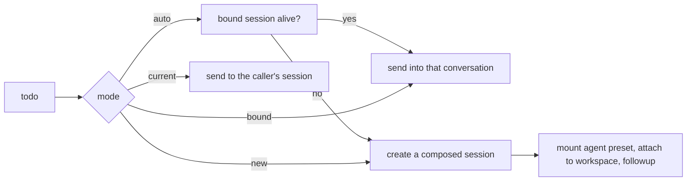

# Design

This document records what the plugin is made of and, more usefully, **what it
deliberately is not**. The rejected alternatives are the interesting part: each one
looked reasonable and was dropped for a reason worth keeping.

## The record

One todo is one plain JSON object. No class instance, no `Date`, no `undefined` —
so the file stays readable, hand-editable and diffable.

| Field | Type | Notes |
|---|---|---|
| `id` | string | `t-` + 8 hex; unique within the file |
| `title` | string | 1–200 characters, trimmed |
| `description` | string | up to 10 000 characters, Markdown-ish plain text |
| `status` | `open` \| `doing` \| `done` \| `cancelled` \| `archived` | `doing` means someone is on it; `archived` keeps the record out of the active view without deleting it |
| `priority` | `low` \| `normal` \| `high` \| `urgent` | `urgent` was added in front of the first three; `normal` stays the default |
| `dueAt` | ISO-8601 string \| `null` | canonicalised to UTC on write |
| `tags` | string[] | ≤ 20, each ≤ 32, de-duplicated case-insensitively |
| `links` | `{ kind: 'url' \| 'file', value, title }[]` | documents and addresses |
| `createdAt` | epoch ms | **written once, never rewritten** |
| `updatedAt` | epoch ms | last accepted change |
| `createdBy` | `human` \| `agent` | which side added it |
| `updatedBy` | `human` \| `agent` | which side changed it last |
| `doneAt` | epoch ms \| `null` | set on `done`, cleared on leaving `done` |
| `sessionId` | string | the conversation this todo owns; `''` until handed off |
| `originDir` | string | the working directory it was written from; resolves a hand-off's cwd |
| `originSessionId` | string | the conversation that wrote it; the panel groups by this |
| `lastDispatch` | `{ at, mode, ok, sessionId?, error? }` \| `null` | last hand-off, including its failure reason |
| `completion` | `{ at, by, summary, sessionId, artifacts }` \| `null` | what the finishing turn said and produced; cleared on reopen |
| `notes` | `{ at, by, text }[]` | append-only progress notes, capped at `LIMITS.notes` |
| `activity` | `{ at, by, kind, summary? }[]` | trimmed to `activityLimit` (default 50) |

The activity kinds are `created`, `updated`, `status`, `done`, `reopened`, `linked`,
`unlinked`, `dispatched`, `dispatch-failed`, `noted`, `completed`.

## Storage

```
$DSH_HOME/global-todo/todos.json     ← { version: 1, todos: [ … ] }
```

- **Atomic writes**: payload goes to `todos.json.<pid>.<ts>.tmp`, is flushed with
  `fsync`, then `rename()`d over the target. A crash leaves either the old file or the
  new one, never half of either.
- **Serialized updates**: every mutation runs through one promise chain, so a
  read-modify-write from the panel can never clobber one from a tool (and a rejected
  write does not wedge the chain for later operations).
- **Tolerant loads**: a record without an `id` or a `title` is dropped, an unreadable
  attachment is dropped, and an unknown `status` falls back to `open`. The rest of the
  list survives.
- **Loud failures**: unparseable JSON, or a `version` newer than this plugin understands,
  raises `store-corrupt` and **refuses to write**. Silently starting over would destroy the
  only copy of the user's list.
- **No migration code yet**: `SCHEMA_VERSION` is 1. The loader already refuses a newer
  version, and a future migration step would run before the first write, keeping the old
  file as a backup.

## A shared file changes without asking

The list is deliberately portable — a notes repo, a synced folder, a NAS — so another machine
writing the same file is a normal event. It must not be a silent one either: the store keeps a
`mtimeMs:size` fingerprint of the file as it last read or wrote it, and a read that disagrees
means somebody else changed it. That is counted once per change (not once per poll, which would
be noise) and exported through `describe()` as `externalChanges` / `lastExternalAt`; the panel
turns a new count into a one-line notice. `store.read` still trusts a file that parses, because
**this process** has no way to merge two writers' intent — but the person can now see that it
happened instead of discovering it a day later.
## Attachments: references, not uploads

An attachment is either an address (`http`/`https`) or an absolute path. Rules:

- a bare string is classified by content (`http(s)://` → address, otherwise document);
- documents must be absolute — a relative path would resolve differently in every session;
- URLs with `user:password@` are refused outright (they would persist a secret into the
  list, the activity trail and every dispatch prompt);
- with `requireExistingFiles: true`, a document that is not on disk yet is refused;
- the title defaults to the host and path, or to the basename, so a row never shows a
  bare 200-character path.

**Rejected: copying bytes into an attachment store.** It was the obvious symmetry with
image attachments, and it is worse here. A copied document goes stale the moment someone
edits the original, doubles the storage, needs size and MIME limits, and still has to be
located by an agent that would rather read the real file. A reference has none of those
problems. The cost — a moved file leaves a dead path — is visible and repairable, unlike a
silently stale copy.

**Rejected: images only.** What people attach to a work item is a spec, a plan, a log or a
link, not a screenshot. Image support can be added later without changing the shape:
`kind: 'image'` alongside `url` and `file`.

## Dispatch



- The todo's prompt is built by `service.dispatchPrompt`: title, description, attachments
  with their kind, due time, tags, **the creation time** and the todo id, then one explicit
  instruction to mark it done with `global_todo_done`.
- New sessions are created through `ctx.root`, not through the plugin's own fiber, so
  disabling or updating the plugin does not tear down work it started.
- `setup` mounts the agent preset — without it the new session would have no tools and no
  system prompt, which is the failure mode that looks like "the agent ignored my todo".
- The message is a **content block array** (`[{ type: 'text', … }]`) with
  `source.kind = 'plugin:dsh-global-todo'`. A bare string here corrupts the session record.
- Every attempt is recorded on the todo, success or failure.

**Rejected: auto-running todos on a schedule.** Tempting, and it turns a human-owned list
into a job queue nobody asked for. A person decides when work starts; the plugin only makes
starting it cheap. Scheduled execution belongs in a scheduler plugin.

**Rejected: `agents.create` without a preset.** It looks simpler and produces a session
that can do nothing.

## Undo, not "are you sure?"

Deleting a todo is the one destructive action in the panel, and a modal
confirmation is the wrong answer to it: it taxes every deliberate delete to
catch the rare misclick. Instead the record is removed immediately, the toast
holds it for eight seconds, and 撤销 puts it back through `POST /restore`.

Restore re-inserts the record **verbatim** — id, `createdAt`, attachments and
the activity trail — instead of re-creating it from the fields. That is why the
route takes a whole record and why it refuses an id that is already taken:
merging two different todos into one would be worse than a failed undo.

The menu item still arms a two-step confirm for the second click, because a
delete from a menu is easier to hit by accident than a checkbox.

## Runtime facts are derived, not stored

`sessionId` is stored: it is the conversation this todo was handed to, and it
must survive a restart. Whether that conversation is still **alive** is not
stored — it is asked of the live registry every time the list is read, and
returned as `sessionAlive`.

The rule: anything that can change without the list changing is derived on
read. Persisting it would mean a background job to keep the flag honest, and a
stale "会话在跑" badge is worse than no badge.

## Proactive capture, with a stated ceiling

The agent is asked to record follow-ups on its own initiative — that is the point of a
global list; a list that only fills when someone says "add a todo" is a form field.

The guidance therefore states **both** sides. "Remember things you notice" alone produces
noise, and a noisy list is worse than an empty one, because the user stops trusting it.
So the prompt names the situations that should produce a todo (a follow-up that spans
sessions, a turn ending with a step that should not continue there, an explicit
「记一下」) and the ones that must not (what the current step can finish, the session's own
plan, small talk), and it asks for one line of confirmation rather than a restatement.

`global_todo_capture` exists for the batch case: scanning a conversation and recording what
it contains. It validates entry by entry, so one unusable attachment does not throw away the
rest of the batch — a partial success is reported as a partial success, never as a failure.

The ceiling: **capture ends at the list.** Nothing the plugin does starts work by itself;
"hand it to an agent" is always a human click.


The gate has to be narrower than "remember things": a capture run that re-registers what the list
already holds is how a trusted list becomes noise. So an item is refused, with the reason on the
record, when its normalized title matches a live row, when a close paraphrase (Dice over character
bigrams, 0.8) appears in the last 72 hours, or when the same errand was finished within 7 days.
Archived and cancelled rows are history a person set aside and must not block a new one; the rules
are pure and live in `lib/capture.js` so they can be tested without a store.
## A fallback must never quietly outrank the real rule

The routes are fenced: the Host's connection service decides (`isTrustedApiRequest` against
`--trusted-host`, then browser authentication), and only when that service is missing does the
plugin fall back to its own stricter "loopback only" check.

That fallback ran **always**, because the fence was read once at mount time — before the service
existed — and the captured value stayed `undefined` forever. The symptom was invisible from the
Host: `curl` on `127.0.0.1` passed the fallback happily. Every browser that was not *on* the Host
machine — the LAN address, a tunnel — got `403` on every call, so the whole panel failed while the
health endpoint reported nothing wrong.

Two lessons, both now enforced: resolve a service **when it is used**, not when the plugin mounts
(services register in an order the plugin does not control), and make the active branch
**reportable** — `/health` now names which fence is in force, because a silent downgrade to a
stricter path is indistinguishable from a working system until someone else tries to use it.

## Automatic collection has to be opt-in, bounded, and aimed

Asking a model to remember things on its own initiative works some of the time, which is not
enough for a list whose whole point is not forgetting. So the plugin can also act: after a clean
turn in a conversation the person is actually in, it asks that conversation whether anything needs
following up.

That power is fenced in six ways, because the failure mode is worse than doing nothing — a list
that fills itself with noise gets ignored, and then the real items get ignored too:

- **off until switched on** by a person;
- **only the conversation a person is in**, judged from the same tracker a hand-off uses — never a
  dispatch target, subagent or background run, which would interrupt work with a question;
- **never an exempted workspace**. Some conversations are driven by a machine: a chat companion's
  room is where a person talks, not where work is tracked, and "anything to follow up on?" has no
  business arriving there. The exemption is keyed on the **working directory**, not on a session
  id, because such a session is recreated when it restarts and an id-keyed exemption would quietly
  stop applying — and it is decided before anything about the conversation's state, so the reason
  reported is the exemption rather than whichever timing rule happened to apply. The directory is
  remembered from the conversation's own events rather than looked up when the timer runs: these
  conversations are idle most of the time, and an idle one is exactly the one the Host may have
  unloaded, where a live lookup answers `''` and the exemption would stop applying to the only
  conversations it exists for. A directory nobody can name is therefore treated as **un-askable**
  rather than as exempt-or-allowed: the exemption cannot be checked against a place that cannot be
  named, and the safe direction is silence (`unknown-dir`);
- **only clean turns**: an aborted, failed or truncated turn is not a moment to ask;
- **one question per message the person wrote**. The question is itself a message in the
  conversation, so it restarted the quiet clock, and the answer to it ended a clean turn — which
  put the same conversation straight back in the queue. With the cooldown below set to the same
  half hour as the quiet window, it had always expired by the time that window opened, so a single
  conversation was asked again and again, all night, with nobody there. Only a message a *person*
  typed re-arms a conversation now; model turns, tool results and this plugin's own notices never
  do;
- **a cooldown, booked before the question is asked**, so a repeated event or a failing request
  cannot turn one turn into a loop.

The switch lives on the Host rather than in the panel because the Host is what acts on it: the
panel may be closed when the question is due, and `/health` reports the state so the mirror can
never drift from the thing it mirrors.

### What it did is part of the feature

A gate whose reason is discarded is a gate nobody can debug. The decision layer always knew why a
conversation was skipped — off, exempt, not idle yet, awaiting a person, cooling down — but the
timer kept only the verdict, so `/health` could say `enabled: true` while nothing ever happened and
offer no way to tell why. The whole decision list is reported now (`autoCollect.decisions`, capped
at twenty), along with the last decision, how many candidates are waiting, and in-memory counters
for asked / succeeded / failed / dropped.

The settings file reports how it loaded (`file` / `missing` / `corrupt`) and when. "Off" because a
person turned it off and "off" because the file could not be read looked identical from the panel,
and the second one is a silent failure rather than a decision.

A failed question is not an answer. The booking used to survive a failed request, and
`awaiting-human` then kept that conversation quiet until somebody happened to speak again: one
transient resume failure switched the feature off for that conversation, permanently and
invisibly. A failure now releases the booking, schedules a bounded retry (1 / 5 / 25 minutes,
three attempts), and only then drops the candidate with the reason recorded. The request itself is
bounded too: an `agents.resume` that never settles used to leave the global `asking` flag set,
which silenced the feature for every conversation rather than the broken one.

## An action belongs where its subject is unambiguous

"Collect from this chat" was a toolbar button, and in a global panel "this chat" is a guess: the
panel is the main view, so there is no conversation on screen to mean. Moving the action onto each
conversation's group header removes the ambiguity — the group **is** the conversation — and puts
the result where the reader is already looking, because the collected todos are filed under that
same conversation via their recorded origin.

The toolbar keeps its version only when the current conversation has no group to carry the action,
so the feature never becomes unreachable. That fallback is a consequence of the rule, not a second
code path: it appears exactly when the group version cannot.

## The picker mirrors the sidebar, and hides what the user put away

The conversation list is not decoration: it is the control that decides where work goes. So it
follows the same rules the sidebar follows — ordered by the recency key the shell maintains, and
without archived conversations.

Excluding archived ones is a correctness rule, not tidiness. The user archived a conversation to
stop seeing it; offering it as a hand-off target invites work into something deliberately put
away. For the same reason the list must never *mislead*: two conversations sharing a title get a
short id suffix, and a target that has since been archived is displayed as `(archived)` instead
of being silently replaced by whichever conversation now occupies its position.

## Notes exist so reporting never rewrites the user's text

A todo has one authored field — the description — and it belongs to the person who wrote it. An
agent that needs to say "I did the first half, I am blocked on your approval" otherwise has to
edit that text, which quietly destroys the original request. The note trail is append-only and
capped, so reporting is cheap and a record cannot grow into a log file.

`global_todo_note` is also a **verdict tool** for the completion watcher: a turn that ends
cleanly after writing "this is blocked, here is why" must not be auto-completed, because the
agent already stated the outcome.

Attachment health is the opposite kind of data: it is a fact about the filesystem *now*, not
about the record. So it is computed when the list is read and never written down — a file that
comes back stops being flagged, and no stale flag can outlive the problem it described.

## Placement is inherited, not invented

A hand-off means "continue this work", and work has a home: the workspace that owns the
conversation the todo came from. The first implementation ignored that and placed a new
session by matching its working directory to a workspace — which works only when a directory
is owned by exactly one workspace and the directory is right, and fails visibly otherwise
(the session lands as an unrelated row).

So placement resolves in this order: the workspace the user named, the workspace owning the
conversation that wrote the todo, the workspace owning the conversation it was handed from,
and only then the directory. The owning workspace's path also becomes the new session's
working directory, because two sources of truth for "where this work lives" is one too many.

## The user picks, the plugin stops guessing

Three attempts at working out "the conversation in front of the user" were three chances to
be wrong, and two of them were: a stale main-view retention, then a self-feeding activity
feed, then a grounding that was correct in principle and still not what the person meant.
Inference was the bug, not any individual rule.

So the panel lists the conversations and the user picks one. An explicit pick travels as
`authoritative: true` and the Host uses it verbatim — that field exists precisely so a caller
that *knows* can outrank a heuristic. The list still marks the conversation the Host would
have chosen by itself, and `自动` keeps that behaviour available, but the default is now
something the user can see and change in the same control they press the button next to.

The general shape, worth reusing: when a decision is cheap for a person and expensive to get
wrong for a machine, put it in front of the person and make the current answer visible.

## A plugin's own messages are not the user talking

"The conversation in front of the user" is resolved from activity, and the first attempt
used `api-session/activity`. That feed means "a user-authored durable message advanced the
list" — and a hand-off **is** a user-authored durable message: the plugin injects a
user-role message into the session it hands work to. The result was a feedback loop that
looked like a targeting bug: the first dispatch moved the current conversation to its own
target, so the second click went *there* rather than to the conversation the person was
reading, and the wrong destination stuck.

The fix is to read the session log instead of the derived feed, and keep only
`user/message` events whose `source.kind` is `user`: model turns, tool results, system
prompts and plugin injections all carry a different kind. The smoke test emits exactly that
sequence — a real message, an injected one, another real one — and asserts the tracker
follows the person.

Two lessons, worth applying to any future tracking:

- when a component both **writes and observes** the same stream, it has to distinguish its
  own output, or it will steer itself;
- **in-memory knowledge does not survive a restart**. The tracker is memory-only by default,
  so a Host restart emptied it and resolution fell back to a guess that was hours stale. The
  id is now written beside the data — a file that costs one small write per person message
  and turns "unknown" back into "the conversation you were in".

## Capture is a request for work, not a hand-off

「从本对话抓取」 asks the conversation in front of the user to turn itself into todos. It
reuses the same target resolution as a hand-off — the session the panel names, then the one
the activity feed says the user last wrote in — but it deliberately records nothing: no
`dispatch` entry on any todo, and no completion expectation for the watcher. The outcome of
this request is *new* todos, not a finished one, so treating it as a hand-off would make the
next clean turn close a todo that nobody worked on.

The injected prompt carries the same ceiling as the system guidance: what to record
(follow-ups that span sessions) and what not to (the session's own plan, small talk,
finished work). A capture instruction without that second half reliably produces noise, and
noise is what makes people stop trusting a list.

Levels work the same way the rest of the record does: `urgent` was added *in front of* the
existing three rather than renaming them, so `P0–P3` arrived with no migration — old records
load unchanged and `normal` stays the default.

## The list is grouped by conversation first

A todo written by an agent knows which conversation wrote it (`originSessionId`, captured
from the tool's own execution context). That single field turns out to be the most useful
thing to group by. The reason is the capture feature: one 「抓一下待办」 run records four or
five items at once, so a flat list grows in bursts and stops being scannable — every entry
looks equally urgent because there is nothing to say about where it came from.

So the default dimension is `conversation`: one entry per source conversation, labelled with
its title when the shell knows it and an id suffix when it does not, carrying the count, the
highest level inside it, and a dot for a conversation still running. A conversation that
submitted a single item shows that row directly rather than a header nobody needs to open.
Items added in the panel belong to no conversation and gather under 「手动添加」.

`time` and `level` remain available as dimensions, because the overdue/today buckets answer a
different question ("what is late") and the level view answers "what did I mark urgent".
Grouping is a view concern only: nothing about the record changes.

## "Hand it to the agent" has to mean the agent in front of you

The first version defaulted to `auto`: reuse the conversation this todo already owns, and
open one only if that is gone. Both halves were wrong in practice. The first click on a
fresh todo opened a session the user never asked for, and the second click sent the work
back to *that* side conversation — while the person was talking to an agent in a different
window and expected the work to land there. Nothing was broken; the target was simply
never what they meant.

So the target became explicit and visible:

- the panel's default is `current`, and it prints **which conversation that is** before the
  click (title included when the shell exposes it);
- the Host resolves `current` for itself when the panel cannot: `api-session/activity`
  tells it where the user last wrote, and the conversation the todo was written from is the
  last fallback;
- each candidate must still be a **live** session, so a dead id is skipped rather than
  becoming a target;
- nothing usable means a **refusal with a reason**, never a quietly created conversation.

`auto` survives as "bound → current → new", which is what most people mean by "put it
wherever it belongs", and `new` stays for when a fresh context really is wanted.

## The working directory decides whether a hand-off works

A session without a working directory is not a session with a missing detail: the Host
files it under `_no-cwd`, the file tools have no root, and the agent asked to "go do this"
can do almost nothing. That is exactly what the first version produced — it only set
`meta.cwd` when `dispatchDir` was configured, and the default was empty.

So the directory is resolved explicitly, in this order:

1. what the caller names (the panel sends the directory of the conversation you are in,
   read from the shell's `useSessions` state);
2. `originDir` — the directory the todo was written from, captured from `exec.agent.session
   .header.cwd` when a tool created it;
3. the working directory of the conversation this todo was handed to before;
4. `dispatchDir` from configuration.

If all four are empty the hand-off is **refused**, with a message that says what to do.
A refusal costs one click; a dead session costs the user's trust in the button.

The panel shows the resolved directory before you press it and remembers one you pick, so
the value is never a guess the user cannot see. A bound conversation that lacks a working
directory is flagged on its row **and treated as unusable by `auto`** — reusing it would
reproduce the failure, so `auto` opens a fresh session instead and one click recovers the
todo. `bound` still means what it says: the conversation the user named.

## Finishing by itself, without lying

A hand-off that ends with no record is a hand-off the user has to go check. So the plugin
watches the session it dispatched to and closes the todo when that session's turn ends —
the summary is the agent's closing message, the artifacts are the files the turn changed,
read from `workspace/changes` (or from the `workspaceChanges` recorder when the event does
not carry the list).

The interesting part is not the mechanism, it is the two guards, because a completion
record that is wrong is worse than no record at all:

- **Expectation.** Only a session this plugin just handed work to may be auto-completed.
  Being *bound* is not enough: the user typing "顺便看下另一个事" into that conversation must
  not close the todo. `onDispatched` sets the expectation, the first clean turn consumes it,
  and a stale one expires.
- **Reason.** `turn/end` carries why: only `completed` counts. `error`, `aborted`,
  `interrupted` and `max-tokens` leave the todo open and drop the expectation, so a later
  turn in the same session cannot claim the completion either. A failed job must not wear a
  "done" label — that is the one failure mode that would make the whole list untrustworthy.

Artifacts are stored as *claims*, not as validated attachments: `requireExistingFiles` is
deliberately relaxed for them, because a produced file that has since moved must not cost
the record its completion. Reopening a todo clears the record, since it describes a finished
job.

Two things about the timing and the veto are worth writing down, because both were wrong
first:

- **The evidence arrives after the verdict.** `turn/end` says the turn closed; the
  `workspace/changes` event that names the files it touched is appended *later*, because the
  recorder enqueues a snapshot and a diff at turn end. Reading the buffer at `turn/end`
  produced a completion with no artifacts every single time. The completion now waits for
  that summary, bounded by a grace period so a turn that changed nothing still finishes.
- **A stated answer beats a heuristic.** If the agent used a verdict tool during the turn
  (`global_todo_done`, `global_todo_update`, `global_todo_remove`), auto-completion stands
  down. This plugin's own prompt tells the agent "if you cannot finish, say where you are
  stuck and do not mark it done" — a watcher that then marks it done would make that
  instruction a lie. Read-only tools are deliberately excluded: looking is not deciding.

The model path (`global_todo_done` with `summary` and `artifacts`) stays the primary one —
it says more than a transcript can. The watcher is the safety net for the agent that forgot,
and it is deliberately written to never throw: an observer that could break a turn would be
much worse than a todo left open.

## Quiet is not a verdict

One attempt at being helpful went the other way, and the reason is worth keeping.

The idea was a second safety net, for todos an agent finished but never dispatched: when a
conversation that *wrote* todos had gone quiet for the idle window after a clean turn, close the
ones it owned — reversibly, with a summary saying why, and only ever its own. On the night it
shipped it closed eight todos that were not finished: one waiting on the person to make a decision,
one waiting on an event that had not happened yet. The only thing that gave them away was the
template summary, because there was no other evidence behind it at all.

The flaw is not the threshold, it is the signal. A conversation falls quiet *because* it is
waiting — on a person, on a reply, on a scheduled thing. So silence is not merely weak evidence of
"finished"; in exactly the cases that matter it is evidence of the opposite, and no idle window can
rescue a signal that points the wrong way.

What remains is only the paths that carry evidence:

- the agent's own `global_todo_done` — it said so;
- the hand-off watcher above — the plugin handed that work over and watched the turn end;
- the panel — a person clicked.

Silence belongs to none of them, so the heuristic is gone, and the module with it. If the safety
net is wanted back it has to come from a positive signal — an explicit "an agent is still on this
one" mark on the todo, defaulting to *not* finished — rather than from a conversation going quiet.
The regression test is `test/smoke.test.mjs`, "a quiet conversation never has its open todos closed
for it".

## Where the human and the agent meet

Both writers call the same `service` functions. That is the whole design: validation, the
audit trail, the write lock and the dispatch rules cannot drift between the panel and the
tools, because there is only one implementation of each.

`createdBy` / `updatedBy` / `activity` exist so a person can tell at a glance whether an
item came from their own hands or from an agent's turn.

That only works while nothing along the way has to guess. An agent tool call is recorded as
the agent, because that is what it is. A **route** records the person by default — the
panel's own click — and takes an explicit `by: 'agent'` from a script acting for one, because
the alternative is a caller that has to impersonate a person in order to be allowed to write.
A value that is neither is refused rather than filed under `human`: absorbing a typo into the
wrong provenance is the failure all of this exists to prevent.

Reopening gets the same treatment. `global_todo_done` can set any status, but *a wrongly
finished item* is a different intent with a different guard, so `global_todo_reopen` does
exactly that one thing (`done` / `cancelled` → `open`), puts the reason in the activity trail,
and refuses an item that was never finished. One obvious entry point beats a capability
buried inside the tool whose name says the opposite.

## Optional services

| Service | Needed for | Without it |
|---|---|---|
| `tools` | the ten agent tools | the panel still works; the model sees no tools |
| `webServer` | the panel's HTTP routes | the tools still work |
| `agents` | handing a todo to a session | the ▶ button reports `agents-unavailable` |
| `agentPresets` | composing a new session | a session is created without a preset (documented, degraded) |
| `workspaceRegistry` | grouping a new session | the session is created, ungrouped |
| `agentDefaultModel` | inheriting the model | the harness default is used |
| `systemPrompt` | the guidance section | no guidance is injected |
| `connection` | the host request fence | a strict loopback check is used instead |

Everything is obtained through `ctx.inject` (which waits for the service) or a guarded
`ctx.get` (which tolerates its absence). The plugin never imports a `@deepseek-ai/*`
package, so it cannot fail to load because of a version skew in one of them.

## Metrics describe the process, not the list

`/health` answers "is this working". The list is one file the person can inspect, so the
numbers that belong next to it are the ones the file cannot answer: how many hand-offs this
process attempted and how many landed, how many tool calls failed, how big the list has grown
since the process started.

All of it is **in-memory on purpose**. A counter persisted to disk would be a second source of
truth for facts the store already owns — the record's own activity trail says when something
changed, and `docs/ROADMAP.md` already lists the honest cross-restart version of this
("what did the sessions finish this week") as unbuilt. Restarting the process resets the
counters, and the field says so rather than pretending to be cumulative.

The failure mode worth avoiding was a counter that only counts what it can see cheaply: a tool
call that throws is exactly the one a person wants counted, so the wrapper records a failure
when the call rejects *and* when it returns `{ ok: false }`.

## Export and import move the store's own document

A file that is already JSON still needs a round trip to be portable — the point is to move the
list between machines, back it up, or diff it in a repository without hand-editing.

Two rules keep it honest. First, export serializes **the store's document, not the read view**:
`missing` and `sessionDir` are computed for the panel on every read, and writing them back would
freeze today's filesystem state into a file the person then moves somewhere else. Second, an
import is all-or-nothing: one unreadable record fails the whole request with a 400 and nothing is
written. A partial import is indistinguishable from data loss, and the person has no way to see
which half landed.

`merge` is the default the panel uses because the destructive operation should not be the one a
stray click reaches. `replace` exists for restoring a known-good backup, and it is exact: the
document that goes in is the document that comes out.

## Rejected storage alternatives

**A SQLite database.** Better for thousands of rows and concurrent readers; worse for the
thing this plugin is actually for. The list is a personal artifact that should be
inspectable in a text editor, greppable, diffable in git and copyable to a phone. SQLite
also drags in a native/engine dependency the plugin does not otherwise have.

**The official `storageDomain` service.** It is the sanctioned place for plugin-owned data
and it persists across restarts. It was rejected as the *only* backend because the file is
the feature here: `storePath` lets a person drop the list into a notes repo or a synced
folder. A storage-domain backend remains a reasonable additive option.

**One file per workspace.** The point of the plugin is a single list that follows the
person between projects, so the file is global and the panel groups nothing by default.

## Compatibility

- Written against the `0.2.x` service surface and the `defineTool`-era output contract
  (`output.schema` + `output.render`), verified on `0.2.1-rc.2` — where the Host also mounts
  its own directory picker, so the panel's picker path is the shell's native dialog and the
  built-in browser is the fallback rather than the normal case.
- The client half depends only on the frozen platform module table (`react`), the
  `sidebar.panellist` and `main` slots, `ctx.locale` and `ctx.slots`.
- Panel colors come exclusively from `--dsw-alias-*` / `--dsw-specific-*` theme tokens, so
  light and dark themes both work; `npm test` fails on a hex or `rgb()` literal in the CSS.
